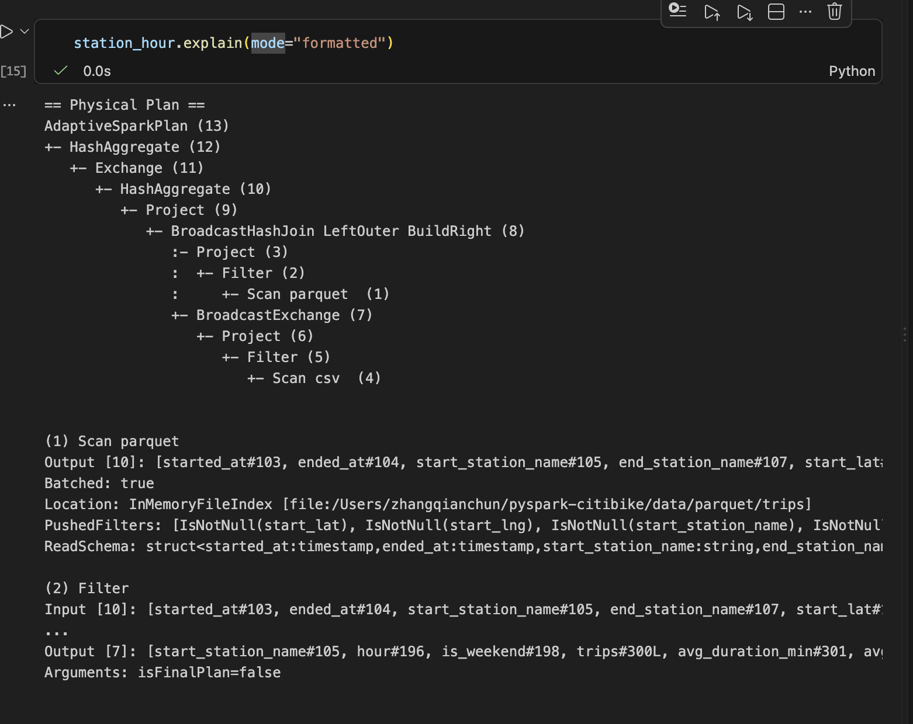
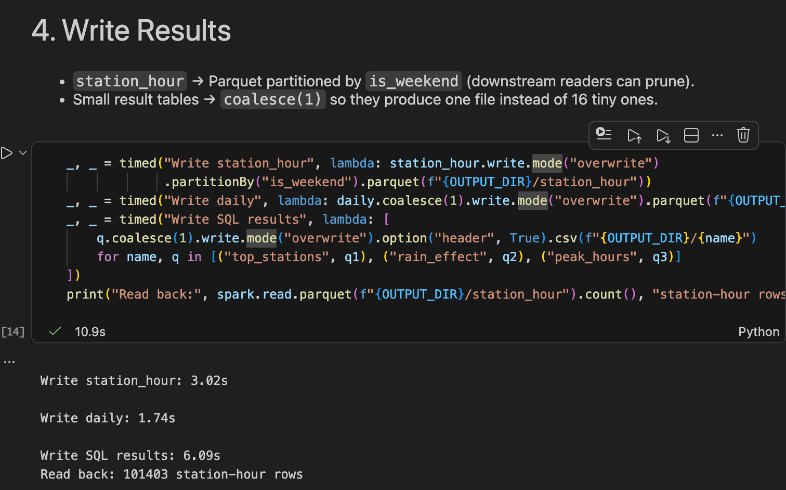
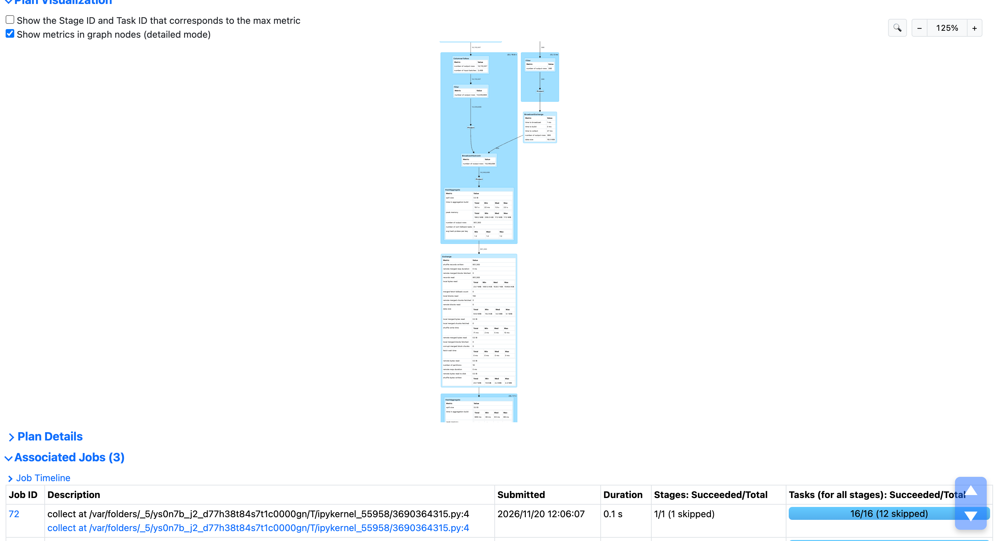
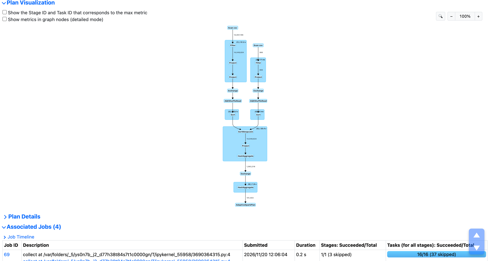
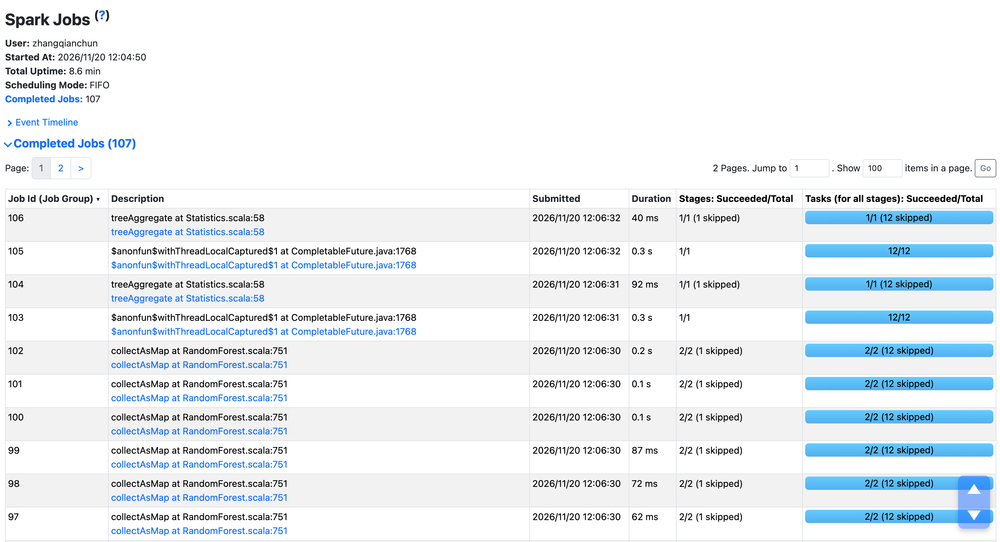
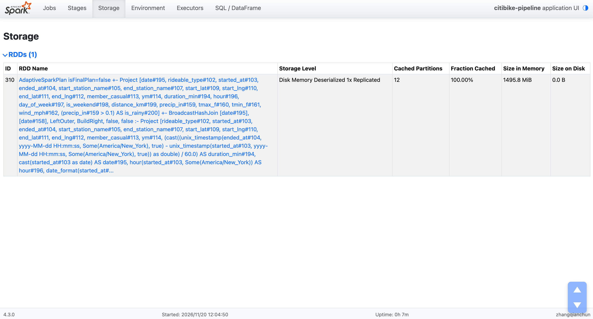

# Citi Bike NYC — PySpark Data Processing Pipeline

IDS706 PySpark assignment. A distributed pipeline that processes **14.1 million Citi Bike trips (~2.6 GB raw CSV, June–August 2024)**, enriches them with NOAA daily weather, and analyzes how Spark optimizes the work: lazy evaluation, predicate pushdown, column and partition pruning, broadcast joins and caching.

- Notebook: [`notebooks/pipeline.ipynb`](notebooks/pipeline.ipynb) (HTML export: [`notebooks/pipeline.html`](notebooks/pipeline.html))
- Environment: PySpark 4.3.0, local mode (`local[*]`) on an Apple M4 MacBook Pro, 8 GB driver memory

---

## 1. Dataset

| Dataset | Source | Size | Description |
|---|---|---|---|
| Citi Bike NYC trip data | https://s3.amazonaws.com/tripdata/index.html (`202406`, `202407`, `202408` `-citibike-tripdata.zip`) | ~2.6 GB CSV (15 files), 14,110,047 rows | One row per trip: ride id, bike type, start/end time, start/end station, start/end coordinates, member vs casual rider |
| NOAA GHCN Daily weather | NOAA NCEI Access Data Service, station `USW00094728` (NY Central Park), 2024 | 366 rows | Daily precipitation (in), max/min temperature (°F), average wind speed (mph) |

Note: the June file contains a handful of trips that started on 2024-05-31 and ended in June, so a small `ym=2024-05` partition appears.

### How to reproduce
```bash
python3 -m venv .venv && source .venv/bin/activate
pip install -r requirements.txt          # needs Java 17+ (brew install openjdk@17)

# trips
cd data/raw
for m in 202406 202407 202408; do curl -O https://s3.amazonaws.com/tripdata/${m}-citibike-tripdata.zip; done
unzip '*.zip' && rm *.zip && cd ../..

# weather
curl -o data/weather/nyc_weather_2024.csv "https://www.ncei.noaa.gov/access/services/data/v1?dataset=daily-summaries&stations=USW00094728&startDate=2024-01-01&endDate=2024-12-31&dataTypes=TMAX,TMIN,PRCP,SNOW,AWND&format=csv&units=standard"

jupyter notebook notebooks/pipeline.ipynb   # Run All; Spark UI at http://localhost:4040
```
`data/` and `output/` are git-ignored because of their size.

---

## 2. Pipeline

```
raw CSV (2.6 GB) ──explicit schema──► Parquet, partitioned by ym (year-month)
        │
        ▼
select 11 columns (column pruning)
filter 1: non-null stations + coordinates      ┐ pushed down into
filter 2: start coordinates inside NYC bbox    ┘ the Parquet scan
withColumn: duration_min, date, hour, day_of_week, is_weekend, distance_km (haversine)
filter 3: 1 ≤ duration_min ≤ 180
broadcast join ◄── weather (366 rows) ; withColumn is_rainy
        │
        ├─► groupBy(station, hour, is_weekend) → trips, avg duration, avg distance, member share
        ├─► groupBy(date, rider type, weather) → daily totals
        ├─► Spark SQL: top stations · rain effect · peak hours (window function + QUALIFY)
        └─► write Parquet (partitionBy is_weekend) + CSV results → output/
```

| Requirement | Where in the notebook |
|---|---|
| Load 1GB+ data | §1: CSV with explicit schema → Parquet partitioned by `ym` |
| 2+ filters | §2: three filters (nulls, NYC bounding box, trip duration) |
| Join | §2: broadcast left join of trips with weather on `date` |
| groupBy + aggregations | §2: `station_hour` (count, avg ×3) and `daily` |
| withColumn | §2: 7 derived columns, including haversine distance |
| 2+ SQL queries | §3: three queries (aggregation, CASE + conditional aggregation, CTE + `RANK()` window) |
| Write results | §4: Parquet (partitioned) + CSV |
| `.explain()` | §5.1–5.3, §6, §7 |
| Caching | §6 |
| Actions vs transformations | §7 |
| MLlib | §8: Random Forest regression |

---

## 3. Performance Analysis

### Measured timings

| Step | Time |
|---|---|
| Count rows from raw CSV | 2.43 s |
| Convert CSV → Parquet (one-time) | 17.96 s |
| Count rows from Parquet | 0.18 s (13× faster than CSV) |
| Count trips in 2024-07 only (partition pruning) | 0.07 s |
| **Naive pipeline** (CSV, no broadcast, join before filter) | **14.91 s** |
| **Optimized pipeline** (Parquet, early filters, column pruning, broadcast join) | **2.02 s** (**7.4× faster**) |

### How Spark optimized the query

Every transformation in the notebook only builds a logical plan. Nothing runs until an action. When an action fires, the Catalyst optimizer rewrites the whole plan at once, and this is visible in the `.explain(mode="formatted")` output for `station_hour` (§5.1). The physical plan collapses the three separate `.filter()` calls, including the duration filter defined *after* several `withColumn` steps, into one `Filter` node directly on top of `Scan parquet`. The derived columns are computed in a single `Project`. The scan line shows **predicate pushdown**: `PushedFilters: [IsNotNull(start_lat), IsNotNull(start_station_name), …, GreaterThanOrEqual(start_lat,40.4), LessThanOrEqual(start_lat,41.0), …]`, so the Parquet reader uses row-group min/max statistics to skip data before it reaches Spark. **Column pruning** goes further than our explicit `select`: `ReadSchema` contains only the 9 columns the final aggregation actually needs. `rideable_type`, `ride_id` and both station ids are never read from disk. For the join, Spark chose `BroadcastHashJoin LeftOuter BuildRight`: the 366-row weather table is copied to every task, so the 14M-row trips table is never shuffled for the join. In the partition-pruning query (§5.2), the plan shows `PartitionFilters: [isnotnull(ym), (ym = …)]`, which means Spark only lists and reads one month's folder.

### Bottlenecks and how the pipeline was optimized

The naive version (§5.3, Spark UI DAG in `screenshots/spark_ui_query_naive.png`) shows where the cost comes from. Interestingly, even though the naive code joins *before* filtering, Catalyst still pushed the filters below the join (the `Filter` sits right after `Scan csv` in its plan). Filter ordering in the code matters less than expected, because the optimizer fixes it. The real cost comes from two other sources. First, **CSV parsing**: CSV is row-based text, so every query re-parses strings and casts timestamps, and this is also why the one-time Parquet conversion takes ~18 s. Second, **the shuffle join**: with broadcast disabled, Spark falls back to `SortMergeJoin`, which adds an `Exchange hashpartitioning(date, 16)` plus a `Sort` on *both* sides. That means shuffling and sorting all 14M trips just to attach one weather row per day. The optimized pipeline removes both. After that, the main remaining bottleneck is the unavoidable `Exchange` required by `groupBy`. Spark limits its cost with partial aggregation: the `HashAggregate → Exchange → HashAggregate` pattern pre-aggregates inside each partition, so the Spark UI shows only **901,383** partial rows crossing the shuffle in the optimized pipeline (1,063,218 in the naive one) instead of ~14M input rows (final result: 101,403 station-hour rows). We also lowered `spark.sql.shuffle.partitions` from the default 200 to 16, which avoids hundreds of tiny tasks on a single machine. Finally, we used an explicit schema instead of `inferSchema` to avoid one extra full pass over 2.6 GB, and `coalesce(1)` for small outputs to avoid writing many tiny files.

### Caching (bonus)

`trips_enriched` (filtered + joined trips) is reused by many later queries. Without caching, every action re-reads Parquet and recomputes all filters, derived columns and the join.

| Action | No cache | Cached | Speed-up |
|---|---|---|---|
| `count()` | 1.24 s | 0.04 s | **28.1×** |
| `groupBy(rideable_type).avg(duration)` | 1.16 s | 0.56 s | **2.1×** |
| First action after `.cache()` (materialization) | – | 6.97 s | one-time cost |

After caching, the plan starts from `InMemoryTableScan` / `InMemoryRelation` instead of `Scan parquet` (§6), and the Spark UI **Storage** tab shows the cached DataFrame: 12 partitions, 100% cached, **1,495.8 MiB in memory**, 0 B spilled to disk. Caching is not free: materializing it costs ~7 s, so it only pays off when a DataFrame is reused several times, as it is here (SQL views, aggregations, MLlib).

---

## 4. Actions vs Transformations

Measured in §7 using Spark job groups and `statusTracker()`:

| Step | Time | Spark jobs launched |
|---|---|---|
| 5 transformations (`filter`, `withColumn`, `filter`, `select`, `groupBy().agg()`) | 27.8 ms | **0** |
| 1 action (`count()`) | 762.8 ms | **3** |

Transformations are lazy: they return a new `DataFrame` object (a plan) instantly and launch no jobs. `.explain()` can print the full plan even though nothing has run. The action `count()` triggers optimization and execution: scan, partial aggregation, shuffle, final aggregation.

---

## 5. Key Findings

- **Commuting dominates weekdays, leisure dominates weekends.** The busiest weekday hours are 17:00 (998K trips), 18:00 and 19:00, which is the evening commute. On weekends, the peak shifts to midday (14:00, 15:00, 13:00).
- **Busiest station: West St & Chambers St** (48,608 trips), on the Hudson River Greenway. Its member share (67%) is lower than at most top stations (80–88%), and waterfront stations like Pier 61 at Chelsea Piers (71%) and 12 Ave & W 40 St (60%) are similar. This points to recreational and tourist riding. The busiest single station-hour is **E 47 St & Park Ave at 17:00 on weekdays** (5,116 trips, 92% members), a Midtown commuter hub near Grand Central.
- **Rain cuts ridership, especially for casual riders.** On rainy days (>0.1 in), average daily casual trips drop **18%** (36,223 → 29,562), versus **12%** for members (119,278 → 105,194). Members ride for transportation and are less weather-sensitive.
- **Casual riders take longer trips:** about 19 min on average versus about 12 min for members.
- **Data quality is high:** 99.6% of trips survive cleaning (missing stations or coordinates, out-of-area GPS points, trips under 1 min or over 3 h).

### MLlib (optional)
A Random Forest regressor (50 trees) predicts **hourly ride counts** from hour of day, weekend flag, precipitation, max temperature and wind. On the test set it reaches **R² = 0.832** and **RMSE ≈ 1,780 trips/hour**. Hour of day carries 93% of the feature importance. Weather matters, but in summer the daily rhythm explains most of the variance.

---

## 6. Screenshots

| Screenshot | File |
|---|---|
| `.explain()` physical plan (PushedFilters, BroadcastHashJoin) |  |
| Successful pipeline execution |  |
| Spark UI — query details, optimized pipeline (Scan parquet + BroadcastHashJoin) |  |
| Spark UI — query details, naive pipeline (Scan csv + SortMergeJoin) |  |
| Spark UI — Jobs |  |
| Spark UI — Storage (cached DataFrame) |  |

---

## Repository structure
```
pyspark-citibike/
├── notebooks/
│   ├── pipeline.ipynb
│   └── pipeline.html
├── screenshots/
├── requirements.txt
├── .gitignore          # data/, output/, .venv/
└── README.md
```
